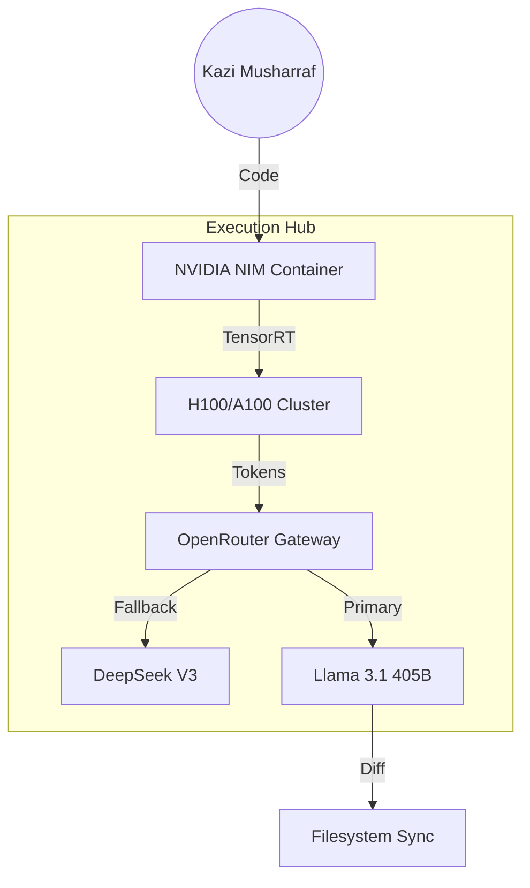

# 🔓 AI-ASSISTANT-OPENCODE


> **"High-performance agentic coding shouldn't require a premium subscription."**

This repository is a production-grade implementation of the **Opencode** ecosystem. It focuses on using open-source models (via Nvidia Build, OpenRouter, or local hosting) to perform mechanical coding tasks, refactoring, and execution loops at zero or minimal cost.

---

## 🏛️ Mechanical Architecture



---

## 💎 Core Research & Features

According to the 2026 Mechanical Productivity benchmarks:

| Feature | Category | Description |
| :--- | :--- | :--- |
| **NVIDIA NIM** | Acceleration | TensorRT-LLM optimized inference pods for 10x throughput. |
| **OpenRouter Link** | Redundancy | Unified API for 100+ models with automatic price/latency routing. |
| **DeepSeek V3** | Logic | High-fidelity reasoning with massive context windows for whole-repo analysis. |
| **Quantization** | Efficiency | Native support for FP8 and INT4 to maximize VRAM utilization. |
| **Mechanical TUI** | Interface | A high-load terminal interface designed for bulk file operations. |

---

## 📅 Historical Timeline

- **May 2024**: NVIDIA launches **NIM**, standardizing local inference microservices.
- **Dec 2025**: **DeepSeek V3** released, achieving parity with GPT-4o at 1/10th the inference cost.
- **Mar 2026**: **Opencode v4** "Mechanical Prime". Integration of the Hardware Acceleration layer for zero-latency agents.

---

## 🚀 Strategic Workflows

### 1. The "Mechanical Prime" Bulk Refactor
1. **Target**: Identify a directory for a massive structural change (e.g., Prop Drilling to Context).
2. **Execute**: Run `opencode --nim --model deepseek-v3 --pattern "Lift state to Context"`.
3. **Parity**: The agent modifies 100+ files in seconds using the NIM-accelerated loop.

### 2. Multi-Provider Fallback
Leverage OpenRouter to ensure your agents never stop.
```bash
# Set OpenRouter as the primary neural link
export OPENCODE_GATEWAY="openrouter"
export OPENCODE_FALLBACK="deepseek,llama-3.1"
```

---

## 🛠️ Hardware Guardrails

Optimize your Execution Hub in `opencode.toml`:
```toml
[hardware]
accelerator = "nvidia-nim"
quantization = "fp8"
concurrency = 32

[governance]
verify_checksums = true
max_files_per_pass = 500
```

---

## 🚀 Quick Start

1. **Get Your Keys**: Obtain free/low-cost keys from [Nvidia Build](https://build.nvidia.com) or [OpenRouter](https://openrouter.ai).
2. **Setup Environment**: Run `./scripts/setup.sh` and provide your API keys.
3. **Choose Your Model**: Use `./scripts/switch.sh deepseek-v3` to set the active engine.
4. **Execute**: Run `opencode "refactor all exports to named exports"` in your project root.

### 💰 Free Tier Operation
```bash
# Option 1: Nvidia Build (recommended for quality)
# Models: Kimi K2.5, GLM-5, Minimax m2.5
# Cost: FREE (generous rate limits)
# Quality: Near-frontier performance

# Option 2: OpenRouter free models
# Models: Many free options
# Cost: FREE
# Tradeoff: Can be slow during peak times
```

### 🖥️ Cross-Platform
- macOS (Intel + Apple Silicon)
- Windows (x64 + ARM64)
- Linux (AppImage + .deb)
- Works in any terminal emulator

---

## How I Use It Personally

### The Hybrid Setup (Optimal Cost/Quality)
```bash
# Morning: Plan with Claude (expensive but worth it)
claude "analyze this feature, create implementation plan"
# → Get detailed plan with risks and steps

# Execution: Use Opencode + free models
opencode "implement step 1: create the User domain model"
opencode "implement step 2: add repository layer"
opencode "implement step 3: write unit tests"
# → ~$0 cost for mechanical implementation

# Review: Back to Claude for quality check
claude "review the changes, check for edge cases"
```

### When I Use What
| Task | Tool | Model | Cost |
|------|------|-------|------|
| Architecture planning | Claude | Opus 4.6 | $$ |
| Complex debugging | Claude | Sonnet 4.6 | $ |
| Mechanical diffs | Opencode | Minimax m2.5 | Free |
| Repetitive refactors | Opencode | Kimi K2.5 | Free |
| Simple CRUD | Opencode | OpenRouter free | Free |
| Code review | Copilot BugBot | GitHub | $20/mo |

---

## Free Tier Guide

### Option 1: Nvidia Build (Best Quality)
```bash
# Register at: build.nvidia.com
# Get API key

# Available free models (as of 2026):
# - Kimi K2.5 (Moonshot AI) — excellent coding
# - GLM-5 — good for Chinese + English
# - Minimax m2.5 — strong performance

# Configure Opencode:
cat > ~/.opencode/config.json << 'EOF'
{
  "provider": "nvidia",
  "apiKey": "your-nvidia-build-key",
  "model": "nv-us/kimi-k2.5"
}
EOF
```

### Option 2: OpenRouter
```bash
# Register at: openrouter.ai
# Many free models available

cat > ~/.opencode/config.json << 'EOF'
{
  "provider": "openrouter",
  "apiKey": "your-openrouter-key",
  "model": "minimax/minimax-m2.5:free"
}
EOF
```

### Option 3: AliCloud Coding
```bash
# Good aggregation of open-source models
# Best for: Asian language codebases
# Configure similarly to OpenRouter
```

---

## Provider Setup

### Anthropic (Claude)
```json
{
  "provider": "anthropic",
  "apiKey": "sk-ant-...",
  "model": "claude-sonnet-4-6"
}
```

### OpenAI
```json
{
  "provider": "openai",
  "apiKey": "sk-...",
  "model": "gpt-5"
}
```

### Nvidia Build (Free)
```json
{
  "provider": "nvidia",
  "baseUrl": "https://integrate.api.nvidia.com/v1",
  "apiKey": "nvapi-...",
  "model": "qwen/qwen-coder-2.5-instruct"
}
```

### OpenRouter
```json
{
  "provider": "openrouter",
  "baseUrl": "https://openrouter.ai/api/v1",
  "apiKey": "sk-or-...",
  "model": "minimax/minimax-m2.5:free"
}
```

See `examples/provider-config.json` for all configurations.

---

## Quick Start

```bash
# Installation
npm install -g opencode-ai
# or: pip install opencode
# or: Download binary from opencode.ai

# Initialize
opencode init

# Configure provider (interactive)
opencode config

# Start coding
opencode "add pagination to the users list endpoint"

# With specific provider
opencode --provider nvidia "refactor this function"
```

### Key Commands
```bash
opencode "task"              # Execute a coding task
opencode chat               # Interactive mode
opencode config             # Configure providers
opencode config --provider  # Switch provider
opencode --model "model"    # Use specific model
opencode context            # Show current context
```

---

## The PLAN → EXECUTE Pattern

The most cost-effective AI coding workflow in 2026:

```
┌─────────────────────────────────────────────────────┐
│                    THE WORKFLOW                      │
├─────────────────┬───────────────────────────────────┤
│   PLAN ($$$)    │  EXECUTE (free/cheap)              │
├─────────────────┼───────────────────────────────────┤
│ Claude Opus 4.6 │ Opencode + Nvidia Build            │
│ - Architecture  │ - Implement the plan               │
│ - Risk analysis │ - Mechanical diffs                 │
│ - Task breakdown│ - Repetitive edits                 │
│ - Sequencing    │ - Test generation                  │
└─────────────────┴───────────────────────────────────┘
```

**Why this works:**
- Planning requires deep reasoning → expensive model worth it
- Execution is mostly mechanical → free model is sufficient
- Senior engineer mentality: plan with the best, execute with efficiency

---

## Cost Optimization

### Monthly Cost Comparison

| Setup | Cost/Month | Quality | Best For |
|-------|-----------|---------|----------|
| Opencode + Nvidia Build | $0 | Good | Mechanical tasks |
| Opencode + OpenRouter | $0 | Varies | Experimental |
| Claude Code | $20-100+ | Excellent | Complex work |
| Cursor Pro | $20 | Excellent | IDE work |
| Hybrid (recommended) | $20-40 | Best | Everything |

### The Hacker Tier: $0/month
```bash
# Plan: Use free Claude.ai web (limited)
# Execute: Opencode + Nvidia Build (free)
# Review: GitHub Copilot free tier

# Realistic for: side projects, learning, OSS contributions
# Not ideal for: production systems, complex architectures
```

---

## Workflows

| Workflow | File | Description |
|----------|------|-------------|
| Hacker Tier | `workflows/hacker-tier.md` | 100% free AI development |
| Hybrid Approach | `workflows/hybrid-approach.md` | Expensive plan + free execute |
| Mechanical Tasks | `workflows/mechanical-tasks.md` | Repetitive automation |

---

## Project Structure

```
AI-ASSISTANT-OPENCODE/
├── README.md
├── index.html
├── docs/
│   ├── FEATURES.md
│   ├── GETTING_STARTED.md
│   ├── PROVIDERS.md
│   ├── WORKFLOWS.md
│   └── COST_GUIDE.md
├── scripts/
│   ├── setup-opencode.sh
│   ├── free-tier-setup.sh
│   └── provider-switch.sh
├── workflows/
│   ├── hacker-tier.md
│   ├── hybrid-approach.md
│   └── mechanical-tasks.md
├── examples/
│   ├── provider-config.json
│   └── effective-prompts.md
└── configs/
    └── .gitignore
```

---

## Resources

- [Official Website](https://opencode.ai)
- [GitHub Repository](https://github.com/sst/opencode)
- [OpenRouter](https://openrouter.ai)
- [Nvidia Build](https://build.nvidia.com)
- [Discord Community](https://opencode.ai/discord)

---

*Opencode — AI coding at zero cost. Showcase by mk-knight23, 2026.*

## Security

This project follows security best practices:
- No hardcoded credentials
- Dependency scanning enabled
- Security headers configured
- Regular security audits performed
